# Gainserv DevOps Practical — app server on AWS EKS

Takes the sample Express app in `app/` (unmodified) from source to a production
deployment on AWS EKS: secure, autoscaling, cost-conscious, all infrastructure
in Terraform.

📹 **Walkthrough recording:** [Watch on Google Drive](https://drive.google.com/file/d/1EoqdSvXt-Y6mJccoaS5L3EgCYjIA8qnJ/view?usp=sharing)

---

## Contents

1. [Architecture](#architecture)
2. [Repository layout](#repository-layout)
3. [How to deploy (steps taken)](#how-to-deploy-steps-taken)
4. [Proof it works (screenshots)](#proof-it-works-screenshots)
5. [Q1 — Security](#q1--security)
6. [Q1 — Scalability](#q1--scalability)
7. [Q1 — Cost](#q1--cost)
8. [Q2 — Terraform](#q2--terraform)
9. [Trade-offs and what I'd do next](#trade-offs-and-what-id-do-next)

---

## Architecture

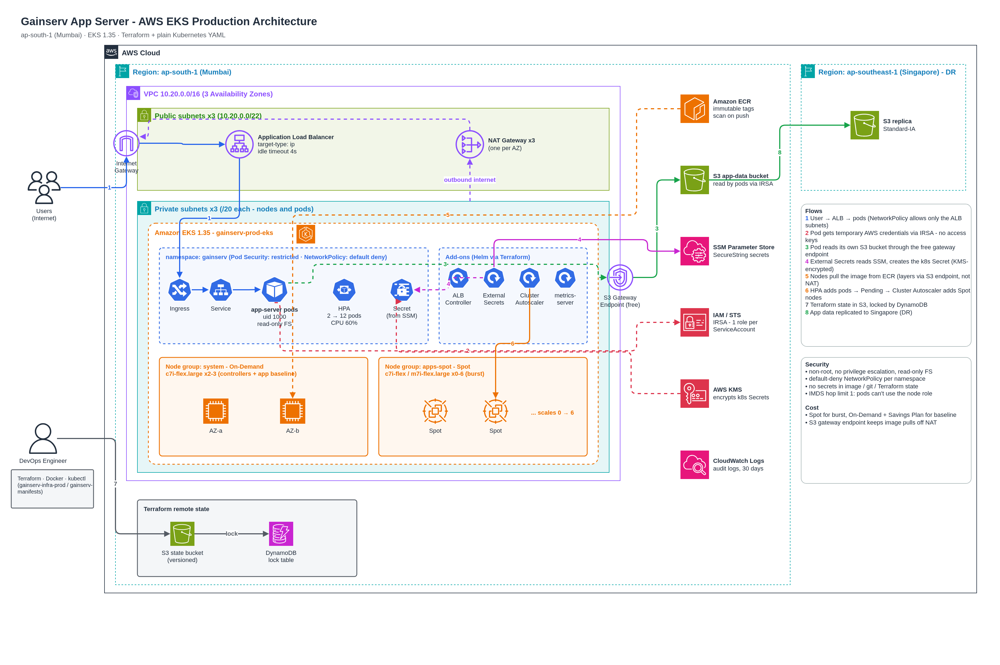

Editable source: [`docs/architecture/gainserv-aws-architecture.drawio`](docs/architecture/gainserv-aws-architecture.drawio) (open in [app.diagrams.net](https://app.diagrams.net) or the VS Code draw.io extension).

Two clear boundaries:

- **Terraform (`gainserv-infra-prod/`)** owns everything AWS *and* the cluster add-ons
  (ALB controller, External Secrets, Cluster Autoscaler, metrics-server). One
  `terraform apply` produces a cluster ready to receive the app.
- **Plain YAML (`gainserv-manifests/`)** owns the app. `kubectl apply`, no templating engine —
  every file is exactly what runs.

---

## Repository layout

```
.
├── app/                          # sample app — UNMODIFIED, exactly as provided
├── Dockerfile                    # multi-stage, non-root, tini as PID 1
├── .dockerignore                 # allow-list: only app/ reaches the build
│
├── gainserv-infra-prod/          # Q2 — Terraform
│   ├── bootstrap/                # S3 state bucket + DynamoDB lock table (run once)
│   ├── main.tf                   # backend, providers, module "VPC" / "EKS" / "IAM" ...
│   ├── locals.tf                 # naming + tagging convention, IRSA role map
│   ├── variables.tf              # inputs, with validation blocks
│   ├── outputs.tf
│   ├── prod.tfvars               # prod values (no secrets)
│   ├── policies/                 # vendored AWS LB Controller IAM policy
│   └── modules/                  # one module per AWS service
│       ├── VPC/                  # subnets, NAT, S3 gateway endpoint
│       ├── eks/                  # control plane, OIDC, KMS, node role, CNI
│       ├── nodegroup/            # one managed node group  (for_each)
│       ├── iam/                  # one IAM role for one ServiceAccount (for_each)
│       ├── s3/                   # app data bucket + DR replica (both provider aliases)
│       ├── ecr/                  # image registry
│       ├── ssm/                  # app secrets in Parameter Store
│       └── eks-addons/           # coredns + Helm releases of the controllers
│
├── gainserv-manifests/           # Q1 — Kubernetes (plain YAML)
│   ├── common/                   # namespace (PSA, readiness gate), quota, default-deny
│   ├── app-server/               # gainserv_app-server_<kind>.yaml
│   │                             #   deployment (+service), hpa, pdb, ingress,
│   │                             #   secrets (configmap + ExternalSecret),
│   │                             #   serviceaccount, networkpolicy
│   └── scripts/                  # gainserv_deploy / status / cleanup / build-push
│                                 # + load, zero-downtime, network-policy, IRSA tests
└── docs/
    ├── architecture/             # AWS architecture diagram (.drawio + .png)
    └── screenshots/              # proof it works
```

---

## How to deploy (steps taken)

**Prerequisites:** AWS CLI (authenticated), Terraform ≥ 1.10, kubectl, Docker, jq.

### 1. Remote state (once per account)

```bash
cd gainserv-infra-prod/bootstrap
terraform init && terraform apply          # S3 bucket + DynamoDB lock table
```

### 2. Infrastructure + cluster add-ons

Edit `gainserv-infra-prod/prod.tfvars`: set `cluster_endpoint_public_access_cidrs` to your
IP (`curl -s ifconfig.me`/32).

```bash
cd gainserv-infra-prod
terraform init
terraform apply -var-file=prod.tfvars       # ~20 min (EKS control plane is most of it)
```

> If the first apply fails on the Helm releases with "Kubernetes cluster
> unreachable", the Helm provider was configured before the cluster existed.
> Run `terraform apply -var-file=prod.tfvars -target=module.EKS` first, then
> the full apply. Second runs are never affected.

Local checks, no AWS account needed:

```bash
terraform init -backend=false && terraform validate && terraform fmt -check -recursive
```

`validate` prints one warning: `"dynamodb_table" is deprecated, use "use_lockfile"`.
That's expected — the brief requires the DynamoDB lock table. See
[What the DynamoDB lock table protects against](#what-the-dynamodb-lock-table-protects-against).

### 3. Set the secret value (never in git / Terraform)

```bash
aws ssm put-parameter --overwrite --type SecureString \
  --name /gainserv/prod/app-server/APP_API_KEY --value "$(openssl rand -hex 32)"
```

### 4. Build, push, deploy

```bash
cd gainserv-manifests/scripts
./gainserv_build-push.sh                    # prints the image
./gainserv_deploy.sh <IMAGE>
./gainserv_status.sh
```

### 5. Tests

```bash
./gainserv_networkpolicy-test.sh            # other namespaces blocked, ALB allowed
./gainserv_irsa-test.sh                     # pod reads its S3 bucket with no keys; everything else denied
./gainserv_load-test.sh 300 40              # spike; watch: kubectl get hpa,pods -n gainserv -w
./gainserv_zero-downtime-test.sh            # rollout under traffic, counts non-200s
```

### 6. Teardown

```bash
./gainserv-manifests/scripts/gainserv_cleanup.sh   # deletes Ingress (-> ALB) then the namespace
cd gainserv-infra-prod && terraform destroy -var-file=prod.tfvars
# bootstrap/ is protected by prevent_destroy on purpose; remove that to delete state storage.
```

Delete the namespace **before** `terraform destroy`: the ALB is created by the
controller, not Terraform, and must be cleaned up while the controller is still running.

---

### Issues hit during the real deployment

| Issue | What happened | Fix |
|---|---|---|
| Free plan instance types | System node group stuck in CREATING; ASG activity: `instance type is not eligible for Free Tier` | Switched to `c7i-flex.large` / `m7i-flex.large` (see Cost). `create_before_destroy` brought the new node group up **before** removing the old one |
| Flaky chart downloads | Helm provider timed out fetching charts from GitHub release assets | Applied the add-ons with `-target` and retried; nothing else changed |
| 502s under load (0.2%) | Load test: 15,854 × 200, 32 × 502. CloudWatch: ALB-generated 502s, **zero** target 5XX/connection errors, spread evenly (not tied to scaling) | Node.js closes idle keep-alive connections after **5s**, the ALB keeps them **60s**; when the ALB reuses a connection Node just closed → 502. App fix (`server.keepAliveTimeout = 65000`) isn't allowed (`app/` is unmodifiable), so the ALB idle timeout was lowered to **4s** (Ingress annotation). Zero-downtime test afterwards: **3,863 / 3,863 × 200** |
| Lock held by a stray plan | A second `terraform plan` failed with `Error acquiring the state lock` while another plan was running | Working as intended: the DynamoDB lock blocked a concurrent run. Stopped the stray plan (it released the lock) and re-ran |

## Proof it works (screenshots)

#### App live behind the ALB
| | |
|---|---|
| `GET /` through the ALB |  |
| `GET /compute` | 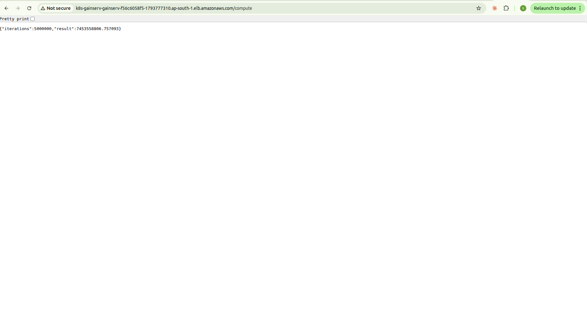 |
| `GET /healthz` |  |
| Internet-facing ALB, 3 AZs (created by the controller from the Ingress) | 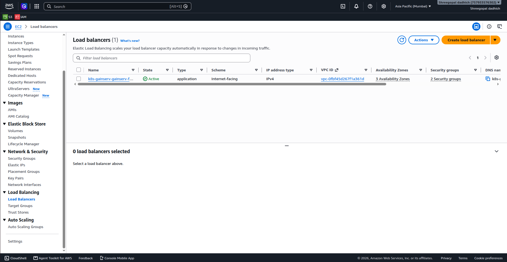 |
| ECR repository — tags **immutable**, AES-256 | 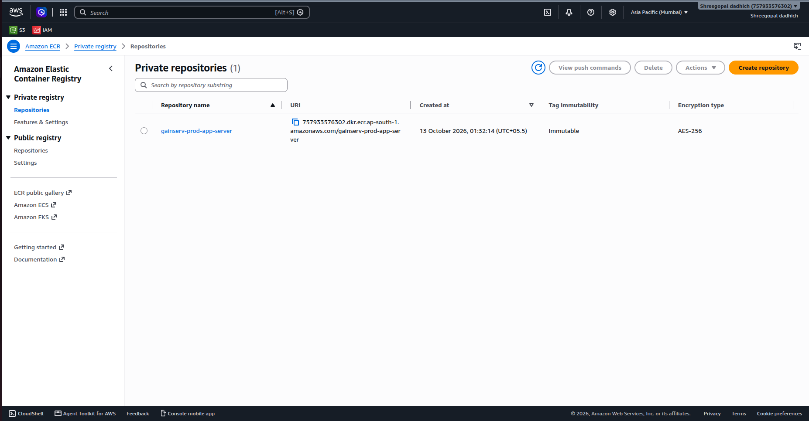 |
| App data bucket (read by the pod via IRSA) | 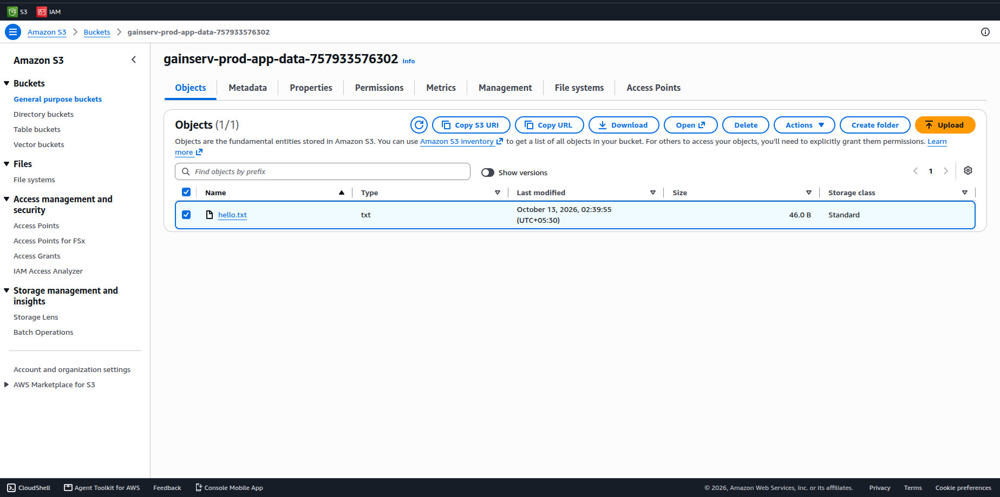 |

#### Security
| | |
|---|---|
| Runs as **uid 1000 (node)**, not root | 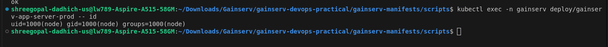 |
| Secret synced from SSM Parameter Store by External Secrets — nothing in git | 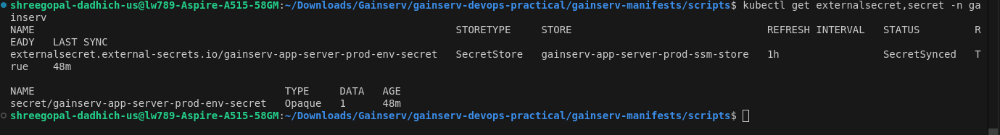 |
| **NetworkPolicy:** pod in another namespace BLOCKED, ALB allowed | 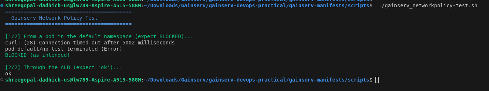 |
| **IRSA:** no access keys in the pod, reads its own bucket, everything else AccessDenied | 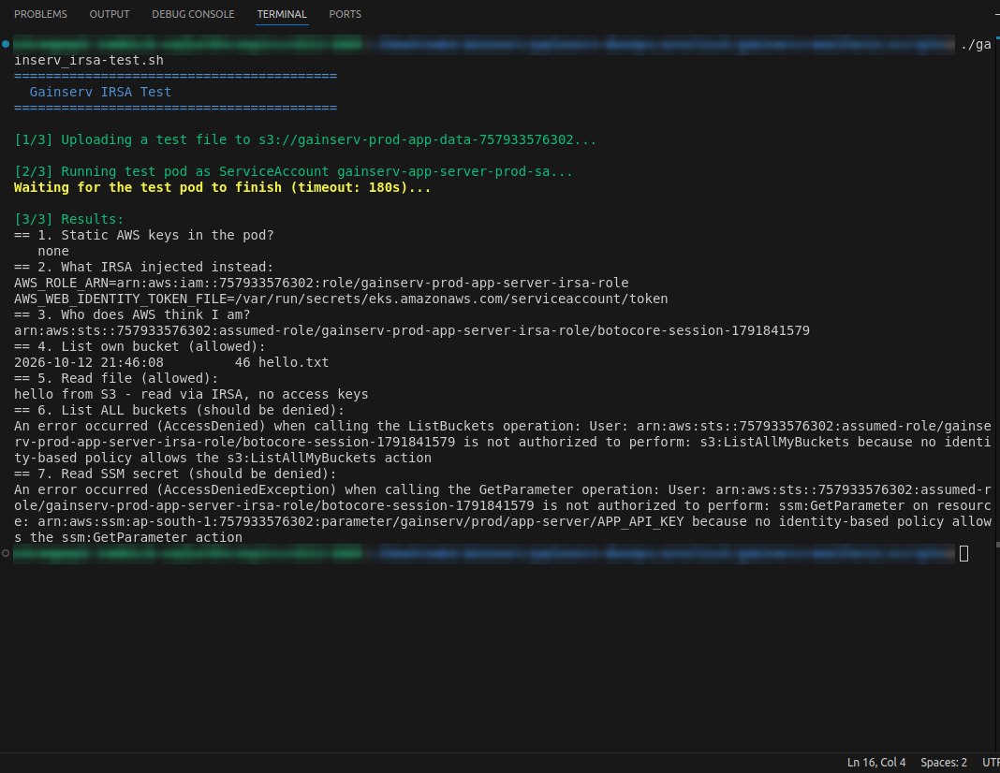 |
| ServiceAccounts annotated with their own IAM roles | 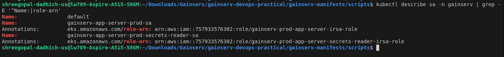 |

#### Autoscaling under load (`gainserv_load-test.sh`, 40 clients, 5 min)
| | |
|---|---|
| On-Demand system nodes at 77-87% CPU as the spike starts | 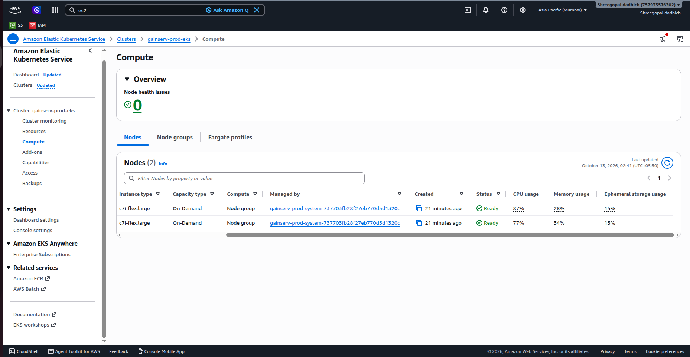 |
| Pods Pending — the signal for Cluster Autoscaler to add nodes | 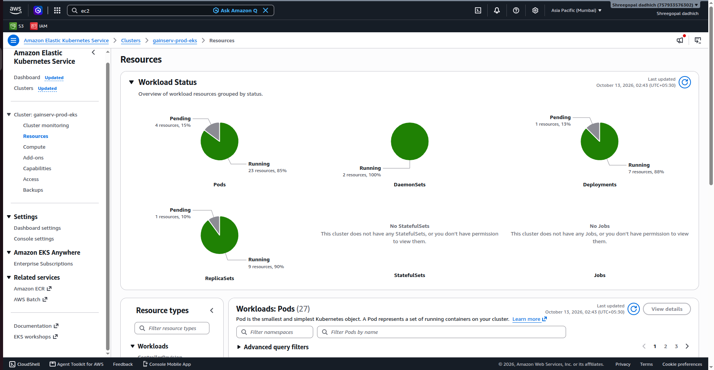 |
| HPA at **12/12 replicas**, all pods Running, 0 restarts | 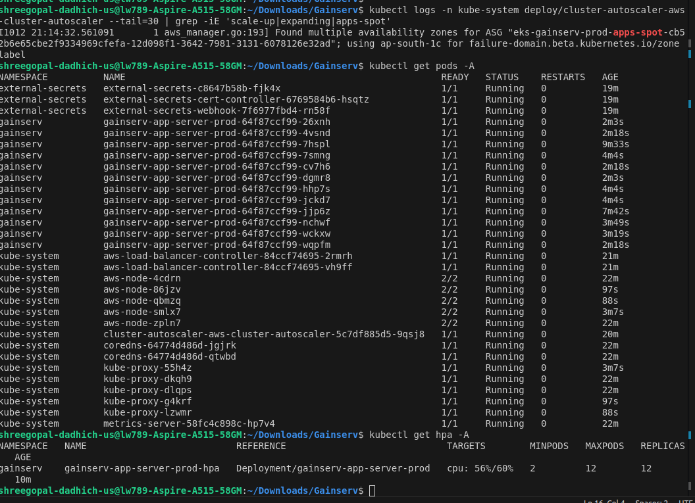 |
| **Spot** nodes added by Cluster Autoscaler (`apps-spot`, c7i-flex.large) | 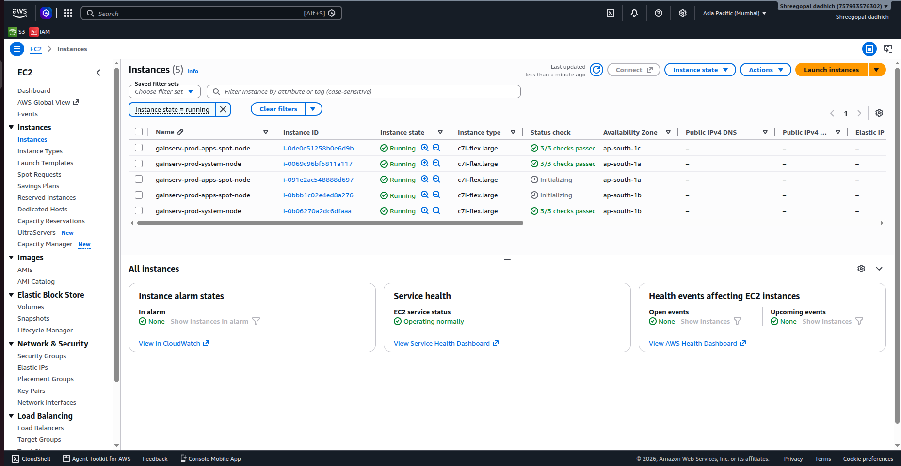 |
| Scale-down: HPA back to 4 pods after the 5-min stabilization window | 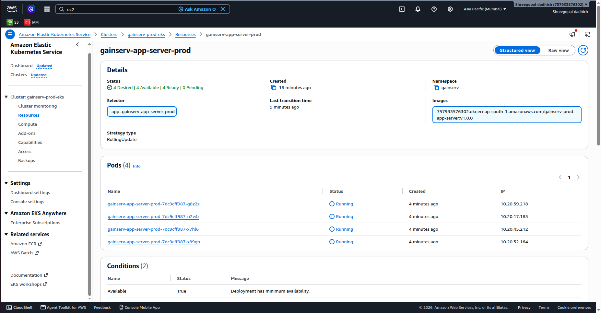 |
| Scale-down: a Spot node removed by Cluster Autoscaler | 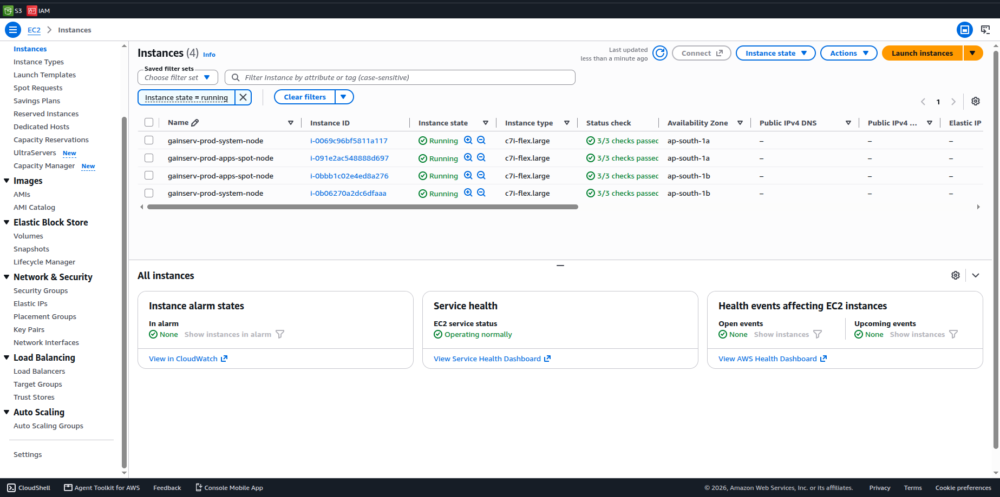 |
| Scale-down complete: back to the HPA minimum of **2 pods**, 0 restarts | 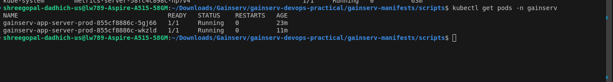 |

Extra: [12 pods running](docs/screenshots/09b-12-pods-running.png), [Cluster Autoscaler log](docs/screenshots/09c-cluster-autoscaler-log.png).

#### Zero-downtime rollout (`gainserv_zero-downtime-test.sh`)
| | |
|---|---|
| Rollout in progress: new ReplicaSet pods start before old ones terminate | 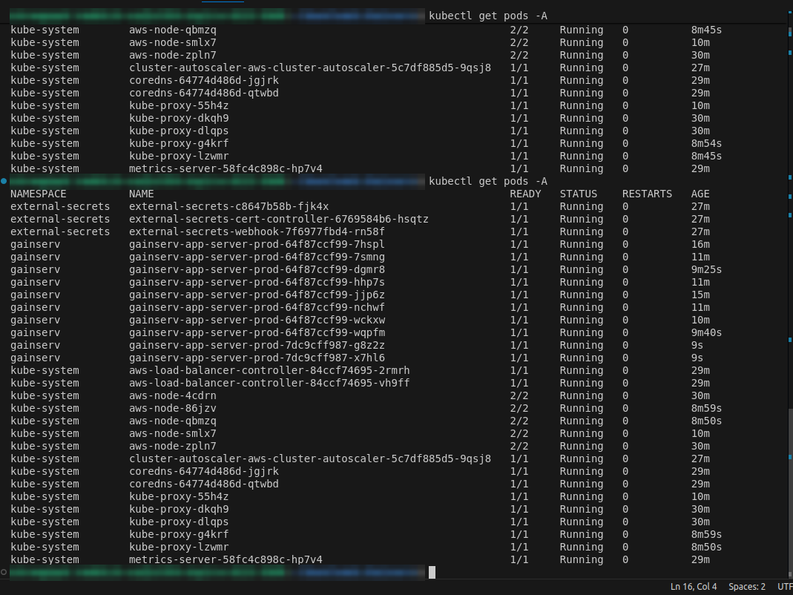 |
| Same rollout in the EKS console (old pods Terminating, new Running) | 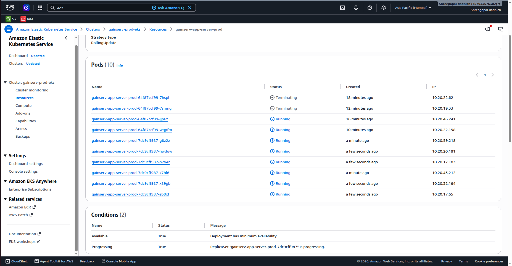 |
| New ReplicaSet taking over | 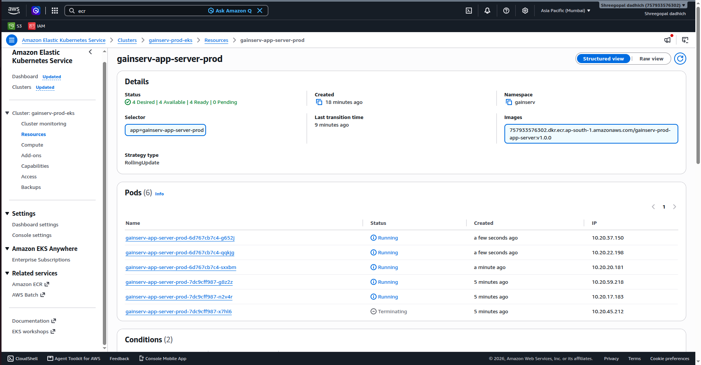 |
| Test running: steady traffic while every pod is replaced | 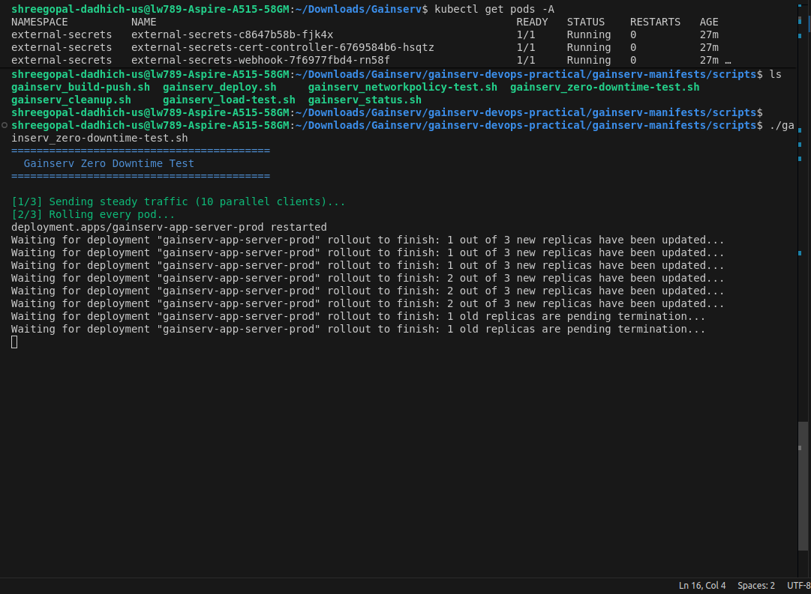 |
| Rollout complete, all pods Ready | 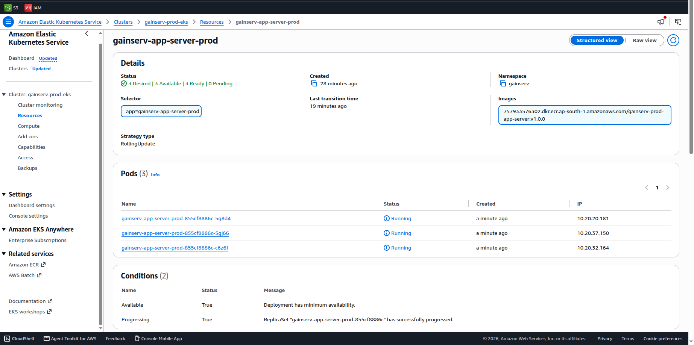 |

Final result of the test: **3,863 / 3,863 requests returned 200, 0 dropped**.

### Measured locally before deploying (drives the sizing below)

Container run with `--read-only --cap-drop ALL --security-opt no-new-privileges --cpus 1`:

| Measurement | Result |
|---|---|
| Runs as | `uid=1000(node)` |
| Memory idle / under sustained load | 16 MiB / 23 MiB |
| CPU under load | 101% — pegs exactly one core, never more |
| `/compute` (default 5M iterations) | ~12 ms |
| `/healthz` while 20 `/compute` requests queued | ~160 ms |
| `docker stop` (SIGTERM → exit) | 0.3 s (tini forwards the signal) |

---

## Q1 — Security

### 1. No root, no privilege escalation
- The Docker image runs as user `node` (uid 1000), not root.
- The pod has `runAsNonRoot: true`, `allowPrivilegeEscalation: false`, all Linux capabilities dropped and a read-only filesystem.
- The `gainserv` namespace has Pod Security **restricted** enabled, so Kubernetes rejects any pod that tries to run as root.

Proof: `kubectl exec ... -- id` shows `uid=1000(node)`.

### 2. No secrets in image, manifest or git
- The secret value is stored in **AWS SSM Parameter Store** (encrypted).
- **External Secrets Operator** reads it and creates the Kubernetes Secret. The pod gets it as an env variable.
- Git only has the parameter **name**, never the value. Terraform creates the parameter with a dummy value and ignores the real one, so it is not in Terraform state either.
- `.dockerignore` only allows `app/` into the image.

### 3. Restrict network access to the pod
- `default-deny` NetworkPolicy blocks all traffic in the namespace.
- The app only accepts traffic **from the ALB subnets on port 3000**. Pods of other teams in the same cluster are blocked.
- Outgoing traffic is allowed only for DNS and HTTPS outside the VPC (AWS APIs like STS and S3). The app cannot call other pods.

Proof: `gainserv_networkpolicy-test.sh` — request from another namespace is **blocked**, request through the ALB works.

### 4. AWS permissions without a static access key (IRSA)
- The pod uses a Kubernetes ServiceAccount that is linked to an **IAM role** (IRSA).
- EKS gives the pod a short-lived token, and AWS STS exchanges it for temporary credentials. No access key is stored anywhere.
- Each ServiceAccount has its own role with only the permissions it needs: the app can only read **its own S3 bucket**.

Proof: `gainserv_irsa-test.sh` — no AWS keys in the pod, reading the bucket works, listing other buckets and reading SSM is **AccessDenied**.

---

## Q1 — Scalability

### 1. Handle a traffic spike and scale back down
- **HPA** scales pods from **2 to 12** when CPU goes above 60%.
- When new pods don't fit, **Cluster Autoscaler** adds **Spot** nodes.
- After the spike, HPA waits 5 minutes and then removes 2 pods per minute. Empty nodes are removed.

Tested with `gainserv_load-test.sh` (40 clients on `/compute`): pods went 2 → 12, Cluster Autoscaler added 3 Spot nodes, then everything scaled back to 2 pods.

### 2. A deploy must not drop requests
- Rolling update with `maxUnavailable: 0` — new pods start before old pods stop.
- Readiness probe and **ALB readiness gate** — a pod gets traffic only after the ALB marks it healthy.
- `preStop` sleep of 25s — the old pod keeps serving while the ALB removes it (ALB drain time is 20s).
- `tini` in the image so the app stops cleanly on SIGTERM.
- PodDisruptionBudget — node drains remove max 1 pod at a time.

Tested with `gainserv_zero-downtime-test.sh`: **3,863 of 3,863 requests returned 200** during a full rollout.

### 3. What breaks first at 10x traffic
Node.js runs on a single thread, and `/compute` blocks it. At 10x traffic, pods get busy before new nodes are ready (Spot node takes ~1.5–3 min). Busy pods answer health checks slowly, get removed from the ALB, and the load moves to the remaining pods. So **the gap while new nodes start** is the first thing to break.

Also, the `iterations` parameter has no limit, so one request can keep a pod busy for minutes.

---

## Q1 — Cost

### 1. Resource sizing
I measured the container first (not default values):
- Memory: 16 MiB idle, 23 MiB under load → **128Mi** request and limit.
- CPU: never more than 1 core (Node.js is single-threaded) → **500m** request, **1 core** limit.
- Nodes: `c7i-flex.large`. Smaller types (t3.micro/small) can't run enough pods on EKS. This AWS account is on the Free plan, so I used the allowed types.

### 2. Spot, On-Demand, Savings Plan
| Where | Option | Why |
|---|---|---|
| System node group (2 nodes, always on) | **On-Demand + Savings Plan** | Runs the controllers and must not be interrupted. Always running, so a Savings Plan gives ~30–40% discount |
| App burst node group (0–6 nodes) | **Spot** | App is stateless and handles shutdown well, ~60–70% cheaper. Scales to 0 when not needed |

### 3. EKS cost trap: NAT Gateway data charges
Every image pull from a private subnet goes through the NAT Gateway, which charges per GB. With autoscaling, nodes pull images often, so this cost grows quietly.

**Guard:** a free **S3 Gateway VPC endpoint**. ECR stores image layers in S3, so image pulls (and the app's S3 reads) skip the NAT completely.

---

## Q2 — Terraform

### Requirements
| Requirement | Where |
|---|---|
| Module with `for_each` over a map | `modules/iam` called with `for_each` over `local.irsa_roles` (one IAM role per ServiceAccount). Also `modules/nodegroup` over `var.node_groups` |
| Variable with a `validation` block | `cluster_endpoint_public_access_cidrs` can never be `0.0.0.0/0`; `vpc_cidr` must be /16–/18; `dr_region` must be different from `aws_region` |
| `locals` for naming and tagging | `locals.tf` — names `<ProjectName>-<Environment>-<resource>` and common tags applied to every resource |
| Two provider aliases, one passed into a module | `aws.primary` (Mumbai) and `aws.dr` (Singapore). Passed with `providers = {...}` into every module; `modules/s3` gets both |
| S3 backend + DynamoDB lock | `main.tf` backend block, created by `bootstrap/` |
| `lifecycle` block | `create_before_destroy` on the EKS node group |
| `validate` and `fmt -check` | Both pass (`terraform init -backend=false`) |

### Why `for_each` and not `count`
`count` tracks resources by **position** (0, 1, 2...). If I remove one item from the middle of the list, all items after it shift, and Terraform deletes and recreates resources I didn't change.

`for_each` tracks resources by **name** (`module.IAM["cluster-autoscaler"]`). Removing one item only removes that item. Nothing else is touched.

### What the DynamoDB lock table protects against
The state file is Terraform's record of everything it created. Without a lock, two people (or a person and CI) can run `terraform apply` at the same time. Both read the same state, and the one that finishes last **overwrites** the other's changes. Resources get lost from state but still exist and cost money.

With the lock, Terraform writes a lock entry in DynamoDB before it starts. A second apply sees the lock and stops with `Error acquiring the state lock`. This actually happened during my deployment and the lock blocked the second run.

### Why `create_before_destroy` on node groups
Changing the instance type needs a new node group. By default Terraform deletes the old one first, so all pods lose their nodes. With `create_before_destroy`, the new node group is created first and the old one is removed after. I saw this happen when I changed instance types — no downtime.

---

## Trade-offs and what I'd do next

| Item | Current | Production next step |
|---|---|---|
| HTTPS | HTTP :80 only (no domain for this exercise) | ACM certificate + `ssl-redirect` annotations (commented in the Ingress) |
| WAF | none | AWS WAF on the ALB with a rate-based rule and a rule capping the `iterations` query param |
| Node autoscaling | Cluster Autoscaler + managed node groups | Karpenter — faster provisioning, better Spot diversification and bin-packing |
| CI/CD | static checks only; deploy from a workstation | GitHub Actions → AWS via OIDC (no stored keys) → push to ECR → deploy |
| Image | ECR basic scan on push | ECR enhanced scanning (Inspector), image signing |
| Observability | control-plane audit logs | Container Insights or Prometheus/Grafana; ALB 5xx and HPA-at-max alarms |
| Secrets rotation | manual `put-parameter` + rollout restart | Secrets Manager rotation for anything that supports it; Reloader to auto-restart on change |
| VPC flow logs | off (cost) | on, to S3 with lifecycle, if compliance requires |
